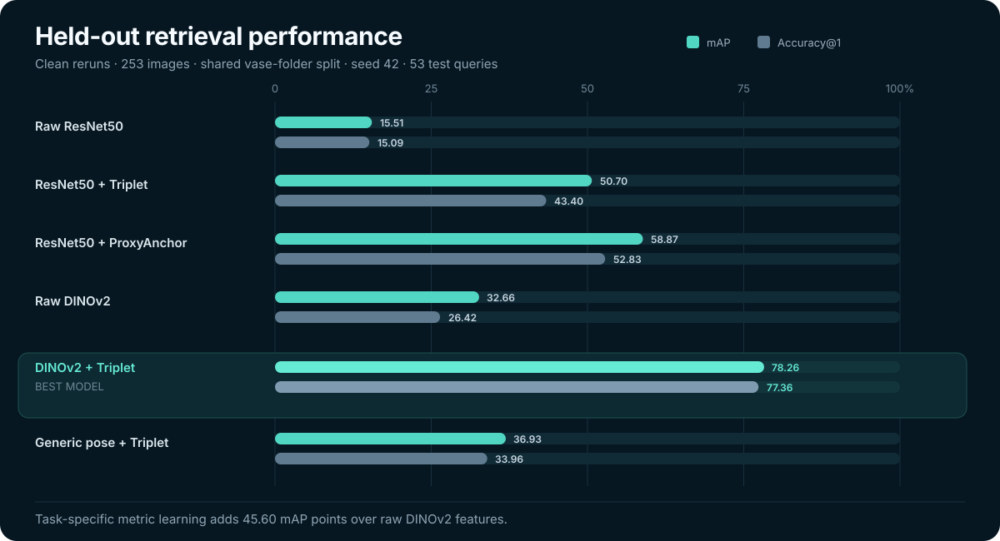

# Fine-Grained Archaeological Vase Retrieval

A computer-vision research project for matching different historical depictions
of the same vase across two parts of the Hamilton engravings dataset.

**Best result:** 78.26% mAP · 77.36% Accuracy@1 · 100% Accuracy@10 (53 held-out queries)
**Best pipeline:** DINOv2 ViT-S/14 features + learned metric embedding + Triplet Loss



The chart uses the clean held-out reruns of 4 September 2026 on all 253 supplied images
(200 training and 53 test images across 80 and 21 vase folders). V6b improves mAP by
45.60 percentage points over raw DINOv2 features. Earlier figures from a 250-image
loader (for example 83.39% mAP for V6b) were superseded by these reruns.

This work was carried out at FAU under the supervision of Mathias Zinnen.

## The problem

The same physical vase can appear with different viewpoints, crops, occlusion,
engraving styles, and visually similar neighboring objects. The task is to take
one depiction as a query and rank the corresponding vase images above all other
candidates.

## What I built

I implemented seven experiment families with the same four-stage structure:

```text
images → feature extraction → optional metric-learning head → FAISS retrieval → evaluation
```

The repository compares:

- raw ResNet50 and DINOv2 features;
- Triplet, ProxyAnchor, and ArcFace objectives;
- full-image features against SAM-based crops; and
- appearance embeddings against vase-specific figure-pose features.

Each experiment keeps its own executable pipeline and SLURM job, while every
version reuses the same folder-level 80/20 split. This makes the comparison
repeatable instead of allowing each method to see a different test set.

## Results

Selected valid runs are shown below. The complete record, including failed and
superseded runs, is in [EXPERIMENTS.md](EXPERIMENTS.md).

| Version | Method | mAP | Acc@1 | Acc@10 |
|---|---|---:|---:|---:|
| V1 | Raw ResNet50 features | 15.51% | 15.09% | 30.19% |
| V2 | ResNet50 + MLP + Triplet Loss | 50.70% | 43.40% | 84.91% |
| V3 | ResNet50 + MLP + ProxyAnchor | 58.87% | 52.83% | 88.68% |
| V6a | Raw DINOv2 full-image features | 32.66% | 26.42% | 83.02% |
| **V6b** | **DINOv2 + MLP + Triplet Loss** | **78.26%** | **77.36%** | **100.00%** |
| V7 | Generic COCO pose (YOLOv8) + Triplet Loss | 36.93% | 33.96% | 67.92% |

The main result is not simply that DINOv2 is a stronger backbone. Raw DINOv2
features reached 32.66% mAP; adapting them to the actual retrieval task with a
learned 128-dimensional embedding raised mAP to 78.26%. The test set is small (53 queries), so
differences of a few points between runs should not be over-interpreted.

### Important negative results

The recorded V4/V5 SAM-crop scores are marked invalid. Their original job
scripts omitted `--model-path`, so evaluation used the raw backbone instead of
the trained heads. The scripts are corrected, but those two runs still need to
be repeated. I keep this failure in the experiment record rather than presenting
the numbers as a valid comparison.

The earlier vase-tuned YOLOv11 pose score (45.55% mAP, V7b) is excluded for a second
reason: an audit on 3 September 2026 found that its pose-training pool overlapped the
retrieval test set (51 byte-identical test images plus one same-named image, 52 in
total; 44 entered pose training and eight entered pose validation). `v7_pose/train_pose.py`
now removes such matches before splitting and aborts if any remain. The clean rerun is
still pending, so V7 above is the generic off-the-shelf pose baseline.

## Repository guide

| Path | Experiment |
|---|---|
| [`v1_baseline/`](v1_baseline/) | Raw ResNet50 baseline |
| [`v2_resnet_triplet/`](v2_resnet_triplet/) | ResNet50 + Triplet Loss |
| [`v3_proxyanchor/`](v3_proxyanchor/) | ResNet50 + ProxyAnchor |
| [`v4_arcface/`](v4_arcface/) | SAM crop + ArcFace |
| [`v5_sam_triplet/`](v5_sam_triplet/) | SAM crop + Triplet Loss |
| [`v6_dinov2/`](v6_dinov2/) | DINOv2 baseline and task-tuned retrieval |
| [`v7_pose/`](v7_pose/) | Generic and vase-tuned figure-pose retrieval |

Every experiment folder contains `extract_features.py`, `retrieve.py`,
`evaluate.py`, a shared `common.py`, and—where training is required—`train.py`.

## Reproduce the best pipeline

Install the dependencies:

```bash
pip install -r requirements.txt
```

Place the dataset under the following structure:

```text
data/pairs_pt1/Bildpaare Teil 1/<vase-id>/*.jpg
data/pairs_pt2/Bildpaare-Triplets Teil 2/<vase-id>/*.jpg
```

Then run V6b from the repository root:

```bash
python v6_dinov2/extract_features.py --output-dir runs/dinov2_triplet
python v6_dinov2/train.py --input-dir runs/dinov2_triplet --output-dir runs/dinov2_triplet
python v6_dinov2/retrieve.py --input-dir runs/dinov2_triplet --model-path runs/dinov2_triplet/model.pth
python v6_dinov2/evaluate.py --input-dir runs/dinov2_triplet
```

Generated models, embeddings, and rankings are written to `runs/`, which is not
committed.

## Reproducibility notes

- The first extraction creates `train_folders.txt` and `test_folders.txt` using
  a vase-folder-level split with seed 42.
- All versions must run from the same repository root so they reuse those files.
- Evaluation retrieves the full test ranking and removes the query itself before
  computing metrics.
- TinyGPU compute nodes have no internet access, so pretrained model weights must
  be cached before submitting a SLURM job.

For the full metric table, run history, caveats, and interpretation, see
[EXPERIMENTS.md](EXPERIMENTS.md).
